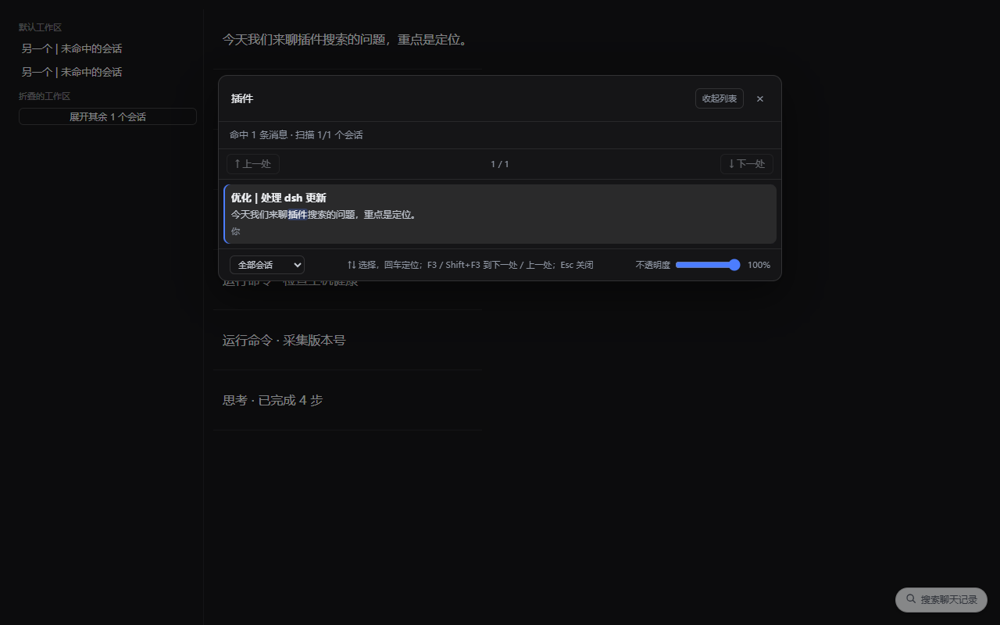
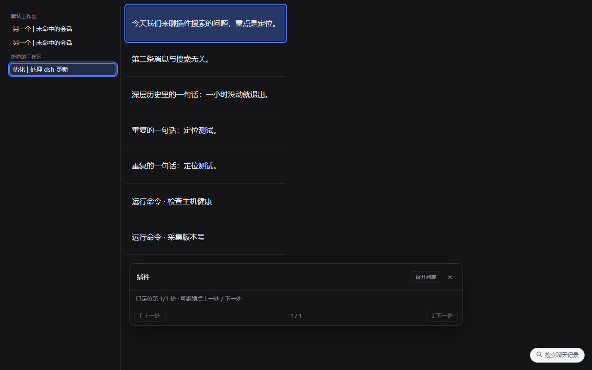

# dsh-session-finder v0.7.0 (2026-10-30)

[English](README.en.md) · [中文](README.md)

Full-text search across every DSH chat session, then **jump to the message that matched**.

DSH's own search opens the session but does not scroll to the hit: its response only carries `{ sessionId, snippet }`, with no event coordinates. This plugin supplies the missing hop — open the session, bring the matching event into the loaded window, then anchor, scroll and outline it.

It brings its own search route instead of calling the host's `sessions.search`, because some deployments configure the session index with `openAt: "never"` and that RPC always answers `SESSION_QUERY_SEARCH_DISABLED`. The host half reads session logs directly through `ctx.sessionPersistence`.





Both screenshots come from the fixture harness (`test/fixture.html`) with fake sessions — not from a real conversation. The Chinese README keeps the per-version screenshots under `docs/`.

## Install

```powershell
# from npm
dsh plugin add dsh-session-finder

# or straight from GitHub
dsh plugin add github:Aizai9527/dsh-session-finder
```

Restart the desktop app afterwards: both the host half and the client bundle load at startup. There is no build step — `lib/*.js` is the shipped artifact. The plugin is listed in the DSH plugin market (awesome-dsh-plugin index).

## Usage

1. Press `Ctrl+Shift+F` (`Cmd+Shift+F` on macOS) or click the pill in the bottom-right corner. The pill can be dragged anywhere and remembers its place.
2. Type at least two characters; separate several keywords with spaces and all of them must appear. An exact phrase ranks first inside its session.
3. **Scope** at the bottom: current session (default — follows the selected sidebar row or the last session you jumped to), all sessions, or one project. Changing it re-runs the query.
4. Results are listed per matching message with role, time and snippet: at most three per session, user messages above assistant replies, both above tool calls.
5. `↑` `↓` to move, `Enter` to locate, `Esc` to collapse the history list (a second `Esc` closes the overlay).
6. After a jump the panel collapses into a nav bar that stays out of the way: `↑ Previous` / `↓ Next`, `F3` / `Shift+F3` or `Alt+↓` / `Alt+↑` keep jumping; the last hit on a page pulls in the next page of older sessions.
7. The matched message and the matched words each get an outline, and the session's sidebar row is marked (folded groups are expanded first). Marks stay until the next jump or until you close the overlay.
8. Up to 8M characters per session are indexed; a page with no hit automatically reads one page of older sessions (max 4 pages / 20 s), and only then says "no match".
9. With an empty input, the last ten queries are listed: click one to search again, `↑` `↓` to walk, `Enter` to take it, "Clear history" removes them all.
10. The opacity slider at the bottom adjusts the panel background (45%–100%) and remembers the setting.

## Limits and side effects

- **Read-only sessions, own cache only.** Sessions are opened with a `read` handle and never written. Extracted text is cached in the host process (64M characters, revision-keyed) and mirrored to `~/.dsh/cache/dsh-session-finder` (gzipped JSON, at most 240 files, oldest pruned by mtime); `DSH_SESSION_FINDER_NO_DISK=1` disables the disk cache.
- **Only visible text is indexed.** `user/message` and `assistant/message` contribute `type: "text"` blocks only; `reasoning`, streaming chunks, `system/message` and `developer/message` are skipped. Tools contribute name, arguments and output text; injected `<system-reminder>` blocks are stripped.
- **Bounded work.** The newest 150 sessions per page, three hits per session, 40 in total, 2.5 seconds, six concurrent readers. When a limit is hit the status line says so and `nextOffset` continues after the last consumed session; a chosen scope is filtered on the host before paging.
- **Jumping uses the chat view's own loader.** When the hit is not rendered, the plugin calls `ctx.sessions.binding(id).session.loadThrough(seq)` until `baseSeq <= seq`, waiting instead of queueing when nothing changes, and stops the background work once the jump lands. Without a binding it falls back to "scroll to top, click again".
- **Three-level anchors, precise to loose.** A tool hit goes to `[data-chat-call-id]`; any other hit first goes to its turn via `data-chat-turn`, then the words are matched inside that turn; only then does it fall back to snippet text. Rows claimed by the same query are not reused — a second hit on the same row reports "not rendered yet" rather than jumping somewhere wrong.
- **History stores query strings only.** `dsh-session-finder:history` holds at most ten queries — no session ids, no hit text, no timestamps — rendered with `textContent`.
- **The overlay background comes from the page.** Only an opaque, neutral `body` background is accepted; a tinted page (for example a warm brand colour) falls back to a neutral dark or light colour.

## Layout

| Path | Role |
| --- | --- |
| `lib/index.js` | Host half: read-only route `GET /session-finder/search?q=&offset=[&sessionId=\|&cwd=]`, scoring, paging, idle warm-up |
| `lib/search.js` | Host half, pure functions: visible-text extraction, reminder stripping, snippet slicing, memory + disk cache |
| `lib/client.js` | Browser half: overlay, scope selector, history, result list, `loadThrough` jumping and outlining |
| `test/*.test.mjs` | Ten check suites: snippets, extraction, route, and static guards for inject, nav, targeting, paging, scope, anchors, history |
| `test/fixture.html` | Manual regression page for the browser half (fake chat DOM with folded blocks, duplicate rows, tool rows, turn rows) |
| `relink.ps1` | Restores the local link mount if a market update drops it |
| `cordis.patch.yml` | Bundle patch that inserts the `session-finder` row |

## Self-check

```powershell
npm run check   # node --check on the three entry points
npm test        # 96 checks
```

Open `test/fixture.html` in a browser for the visual regression; per-version screenshots live under `docs/`.

## Version history

| Version | Date | Change |
| --- | --- | --- |
| v0.7.0 | 10-30 | Disk-backed extraction cache + idle warm-up, 2.5s budget / 150 sessions / 6 readers, jump no longer waits: first wide search 10.2s → 1.7s |
| v0.6.1 | 10-30 | `reachSeq()` retries `loadThrough` until `baseSeq <= seq`; turn anchor via `data-chat-turn` |
| v0.6.0 | 10-30 | Search history: last ten, `↑↓` / `Enter`, clear-all, two-step `Esc` |
| v0.5.1 | 10-30 | Tool hits anchored by `callId`; a query never reuses a row |
| v0.5.0 | 10-30 | Jump via `ISession.loadThrough(seq)`, search scope, draggable panel |
| v0.4.4 | 10-29 | 400k → 8M characters per session, oversized notice, auto-continue when a page is empty |
| v0.4.3 | 10-29 | Sidebar row marking (inset outline), folded groups expanded |
| v0.4.2 | 10-29 | Highlight persists until the next jump, single `clearHighlight()`, panel docks at the bottom |
| v0.4.1 | 10-29 | Nav state collapses to ~135px, two-pass `keepClearOfPanel()` |
| v0.4.0 | 10-29 | Overlay stays open after a jump, prev/next and `F3` |
| v0.3.3 | 10-29 | Panel tint fixed (neutral background only), `uiWorkspace` injected so clicks switch sessions |
| v0.3.2 | 10-29 | Opacity slider, foreground colour picked from the background luminance |
| v0.3.1 | 10-29 | Pill moved bottom-right and made draggable, theme tokens dropped, BOM "package unavailable" fixed |
| v0.3.0 | 10-29 | Visible text only, multi-keyword AND, role/time labels, paging |
| v0.2.0 | 10-29 | Own host route, bypassing the disabled `sessions.search` |
| v0.1.0 | 10-29 | First version: search, open session, locate by snippet |

## License

MIT — see [LICENSE](LICENSE).
